# GitHub Actions CI/CD — Learning PoC

A complete, end-to-end **Continuous Integration / Continuous Delivery / Deployment** proof of concept built with GitHub Actions.

**Purpose:** This repository is an onboarding learning artifact. The pipeline is designed to be *read and understood*, not just run. Every concept is explained here, and the workflow file (`.github/workflows/ci-cd.yml`) is heavily commented so both documents teach the same material.

---

## Table of Contents

1. [Concept Primer](#1-concept-primer)
2. [Lifecycle Diagram](#2-lifecycle-diagram)
3. [Annotated Workflow Walkthrough](#3-annotated-workflow-walkthrough)
4. [How to Design Workflows](#4-how-to-design-workflows)
5. [How to Manage Environments and Gates](#5-how-to-manage-environments-and-gates)
6. [How to Troubleshoot](#6-how-to-troubleshoot)
7. [Run It Yourself](#7-run-it-yourself)

---

## 1. Concept Primer

These are the core GitHub Actions building blocks. Each entry maps to where it appears in this repo.

| Concept | What it is | Where in this repo |
|---|---|---|
| **Workflow** | A YAML file in `.github/workflows/` that defines the entire automation. Triggered by events. | `.github/workflows/ci-cd.yml` |
| **Event / Trigger** | What causes the workflow to run: a push, a pull request, a schedule, manual click, etc. | `on: push` and `on: pull_request` at the top of `ci-cd.yml` |
| **Job** | A group of steps that run sequentially on one runner (VM). Jobs run in parallel by default; `needs:` creates order. | `lint`, `test`, `build`, `deploy-staging`, `deploy-production` |
| **Step** | A single command (`run:`) or reusable action (`uses:`) inside a job. Steps share the same runner filesystem. | Every `- name:` block inside a job |
| **Action** | A reusable, packaged unit of work published to the GitHub Marketplace. Pinned with `@v<N>`. | `actions/checkout@v5`, `actions/setup-python@v6`, `actions/upload-artifact@v4` |
| **Runner** | The virtual machine (or self-hosted server) that executes a job. `ubuntu-latest` = GitHub-hosted Ubuntu VM, free for public repos. | `runs-on: ubuntu-latest` in every job |
| **Artifact** | A file or directory produced by one job and shared with later jobs (or downloadable from the UI). NOT the same as a release asset. | `dist/` wheel uploaded by `build`, downloaded by both deploy jobs |
| **Environment** | A named deployment target (`staging`, `production`) with optional protection rules: required reviewers, wait timers, branch restrictions. | `environment: staging` and `environment: production` |
| **Secret** | An encrypted key-value stored in repo Settings → Secrets, injected as `${{ secrets.MY_SECRET }}`. Never visible in logs. | Not used in this PoC; the deploy is simulated. Real deploys would use `SSH_KEY`, `DEPLOY_TOKEN`, etc. |
| **Concurrency** | Prevents multiple runs of the same workflow/job from overlapping. `cancel-in-progress: true` cancels the older run when a new one starts. | Top-level `concurrency:` (CI) and per-job override for production (non-cancellable) |
| **Context** | Built-in variables provided by GitHub at runtime: `github.sha`, `github.actor`, `github.ref`, `github.event_name`, etc. | Used in the `record deployment` step and `if:` conditions |

### How the concepts nest inside each other

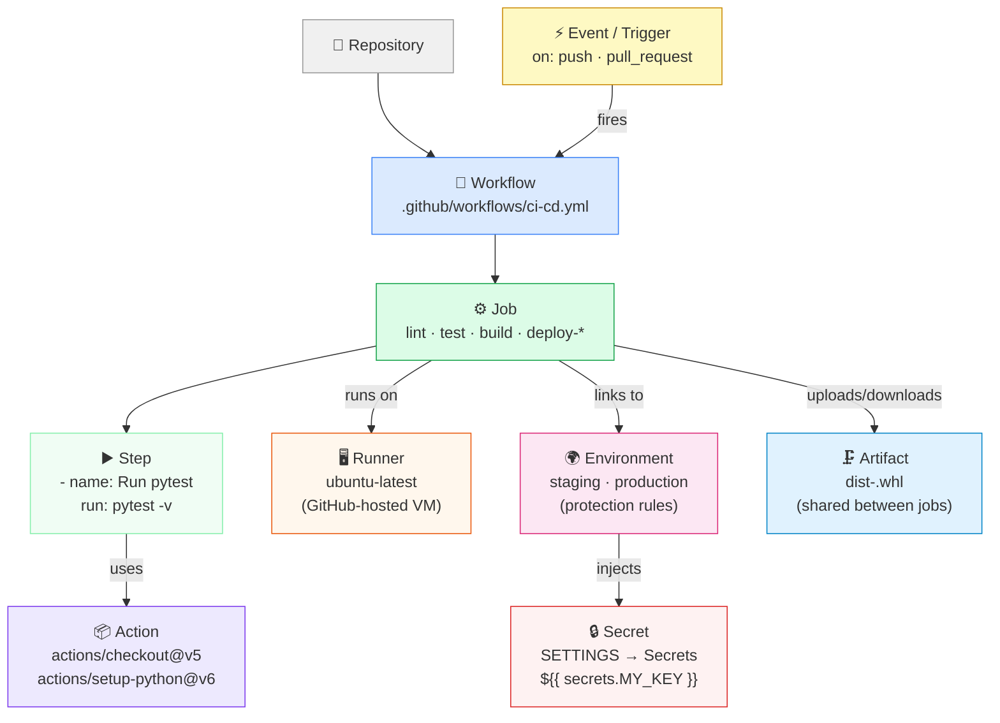

---

## 2. Lifecycle Diagram

### 2.1 — The full journey: from code change to production

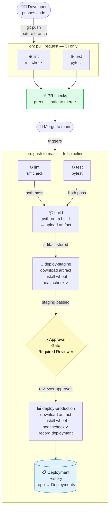

### 2.2 — CI/CD stage definitions

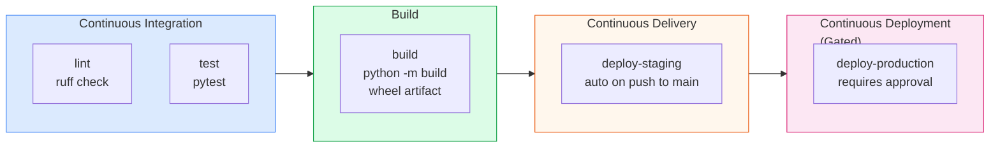

---

## 3. Annotated Workflow Walkthrough

The full workflow lives in `.github/workflows/ci-cd.yml`. This section walks through each key part and explains *why* it is written that way.

### 3.1 — Name and Triggers

```yaml
name: CI / CD Pipeline

on:
  push:
    branches: [main]
  pull_request:
    branches: [main]
```

**Why:** The `name:` is what appears in the GitHub Actions UI — make it human-readable. The `on:` block controls what events fire the workflow. By restricting to `branches: [main]` we avoid running the pipeline on every experimental branch push, keeping runner usage low.

#### Event routing — what runs on each event type

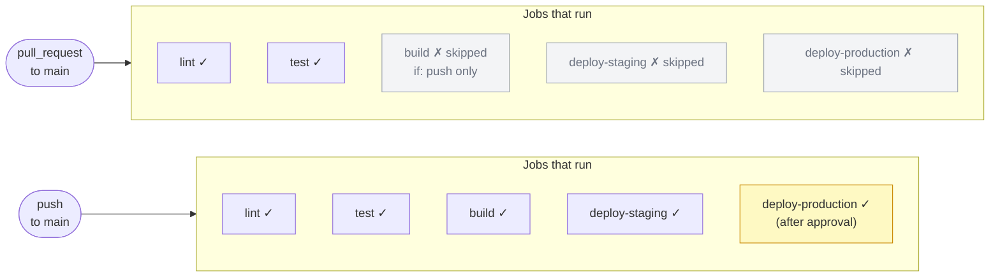

### 3.2 — Concurrency

```yaml
concurrency:
  group: ci-${{ github.ref }}
  cancel-in-progress: true
```

**Why:** Without this, pushing two commits quickly would queue two full pipeline runs that do the same work. `cancel-in-progress: true` cancels the older run when the second starts — saving runner minutes.

#### How concurrency groups work

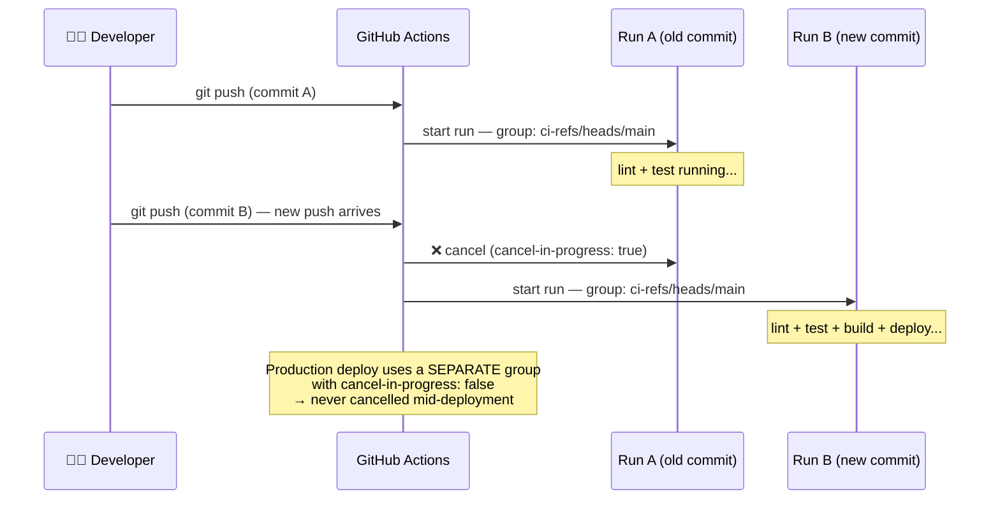

### 3.3 — The `needs:` Chain

```yaml
build:
  needs: [lint, test]

deploy-staging:
  needs: build

deploy-production:
  needs: deploy-staging
```

**Why:** `needs:` creates a *dependency graph*. GitHub runs independent jobs in parallel (lint + test run at the same time), then waits for all dependencies before starting the next stage.

#### Job dependency graph

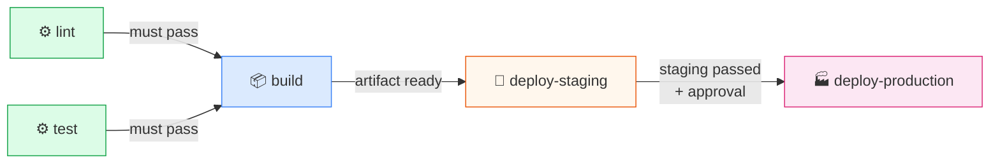

#### What happens when a job fails

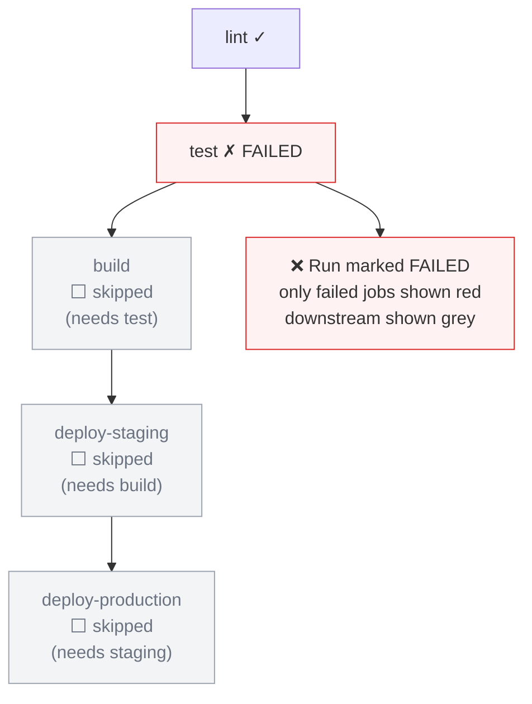

### 3.4 — The `if:` Guard (Deploy Only on Push)

```yaml
build:
  if: github.event_name == 'push'
```

**Why:** On a pull request `github.event_name == 'pull_request'`, so `build`, `deploy-staging`, and `deploy-production` are all **skipped** (shown grey, not failed). PRs should only run CI checks — not deploy anything. One workflow file handles both event types cleanly.

### 3.5 — Artifact Upload/Download (v4)

```yaml
# In build job:
- uses: actions/upload-artifact@v4
  with:
    name: dist-${{ github.run_id }}   # unique per run
    path: dist/
    retention-days: 7

# In deploy jobs:
- uses: actions/download-artifact@v4
  with:
    name: dist-${{ github.run_id }}
    path: dist/
```

#### How the artifact flows between jobs

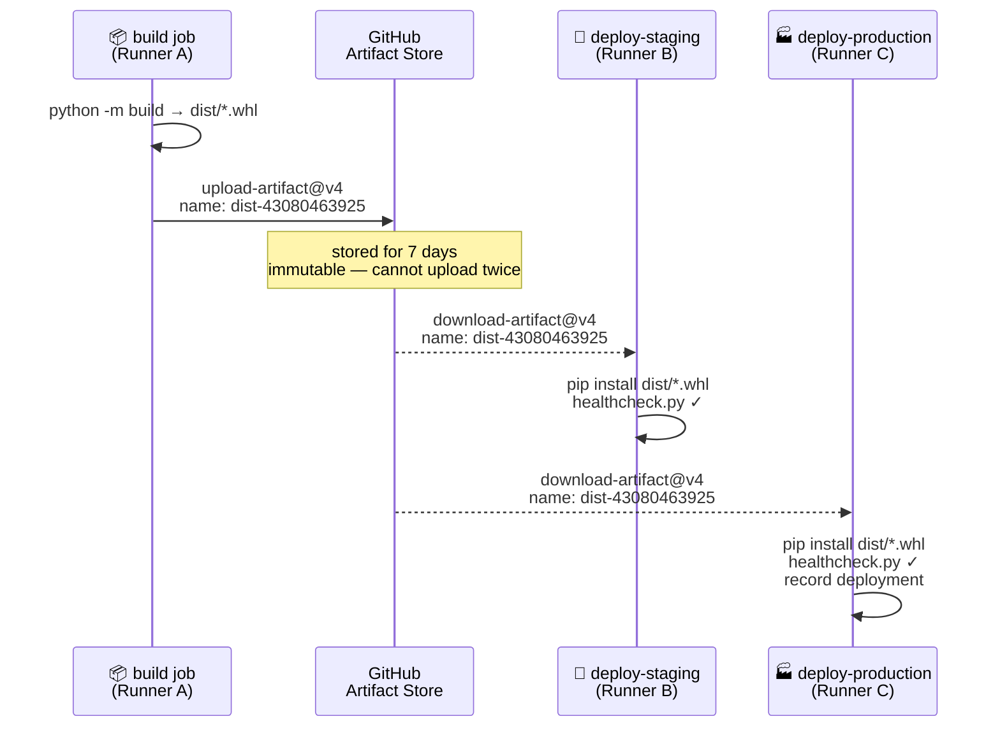

> **Critical:** `upload-artifact@v3` and earlier were **permanently shut down on 2025-01-30** and hard-fail. Always use `@v4`. Artifact names are immutable per run — use `${{ github.run_id }}` to guarantee uniqueness.

### 3.6 — Environments

```yaml
deploy-staging:
  environment:
    name: staging

deploy-production:
  environment:
    name: production    # ← triggers approval gate
```

#### What `environment:` activates

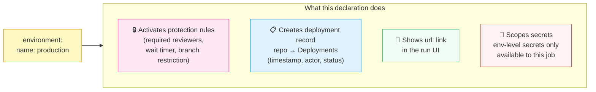

The protection rules themselves are configured in **Settings → Environments**, not in YAML (see Section 5).

---

## 4. How to Design Workflows

### Adding a new job

1. Add a new top-level key under `jobs:`.
2. Give it `runs-on:`, `steps:`, and optionally `needs:` (its prerequisites).
3. Add it to any downstream jobs' `needs:` lists if they should wait for it.

#### Example: inserting a security scan between CI and build

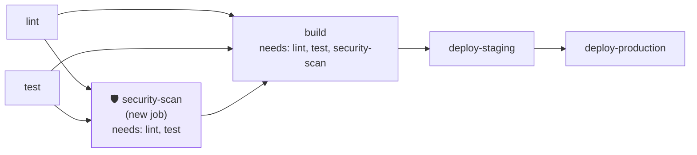

```yaml
jobs:
  security-scan:
    name: Security scan
    runs-on: ubuntu-latest
    needs: [lint, test]
    if: github.event_name == 'push'
    steps:
      - uses: actions/checkout@v5
      - run: pip install bandit && bandit -r src/
```

### Trigger options (common patterns)

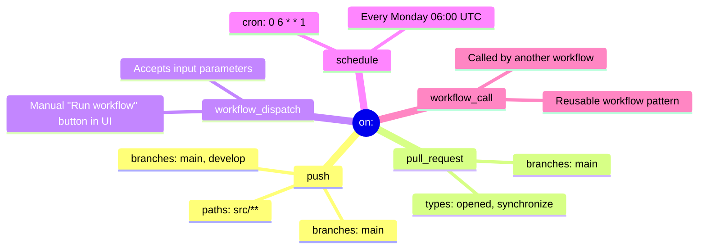

### Build → Deploy artifact hand-off (the pattern)

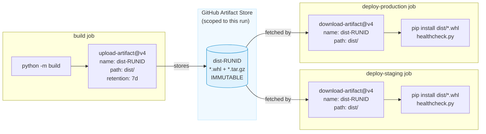

### Action version pinning rationale

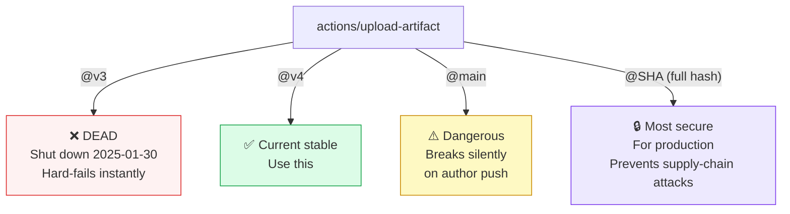

---

## 5. How to Manage Environments and Gates

### Environment anatomy

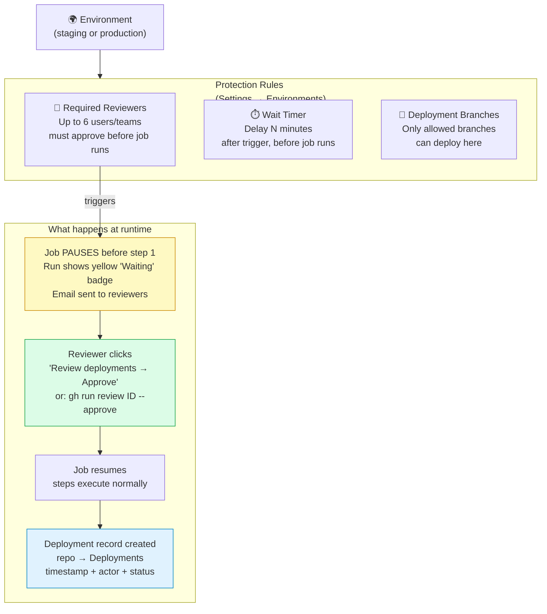

### Approval gate — step-by-step sequence

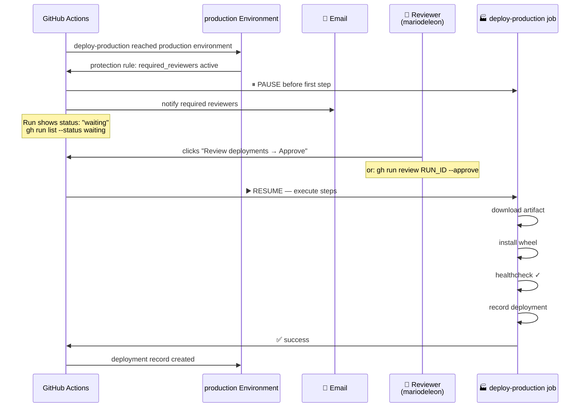

### Creating environments via `gh` CLI

```bash
# Create environments
gh api repos/mariodeleon/cicd-poc/environments/staging -X PUT -f ""
gh api repos/mariodeleon/cicd-poc/environments/production -X PUT -f ""

# Add required reviewer (get your user ID first)
user_id=$(gh api users/mariodeleon --jq .id)
echo '{"wait_timer":0,"reviewers":[{"type":"User","id":'"$user_id"'}]}' | \
  gh api repos/mariodeleon/cicd-poc/environments/production -X PUT --input -
```

### Managing secrets

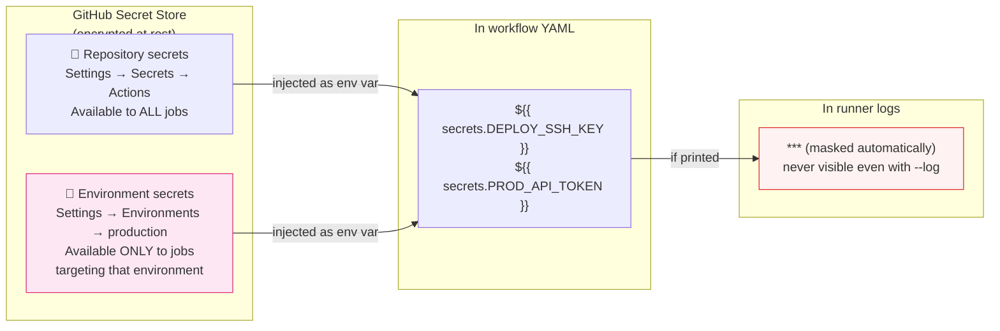

> **Never** hardcode credentials in workflow YAML. Even in private repos — the workflow file is code and must be treated accordingly.

---

## 6. How to Troubleshoot

### Triage decision tree

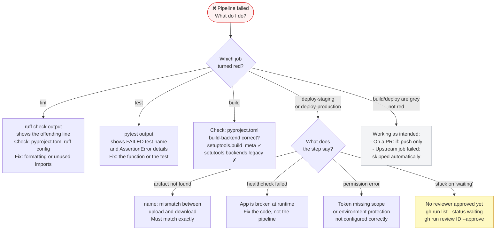

### `gh` CLI triage cheat-sheet

```bash
# List recent runs (shows run ID, status, branch, duration)
gh run list --repo mariodeleon/cicd-poc

# Filter by workflow, branch, or status
gh run list --workflow=ci-cd.yml --branch main --status failure

# Show job summary for a specific run
gh run view <run-id>

# Show ONLY the failed steps' logs — fastest for triage
gh run view <run-id> --log-failed

# Show ALL logs for the entire run
gh run view <run-id> --log

# Watch a live run in your terminal (streams progress)
gh run watch <run-id>

# Re-run a failed run from the beginning
gh run rerun <run-id>

# Re-run only the failed jobs (skips successful jobs)
gh run rerun <run-id> --failed

# Download artifacts from a run to ./
gh run download <run-id>
```

### Worked failure example — full triage cycle

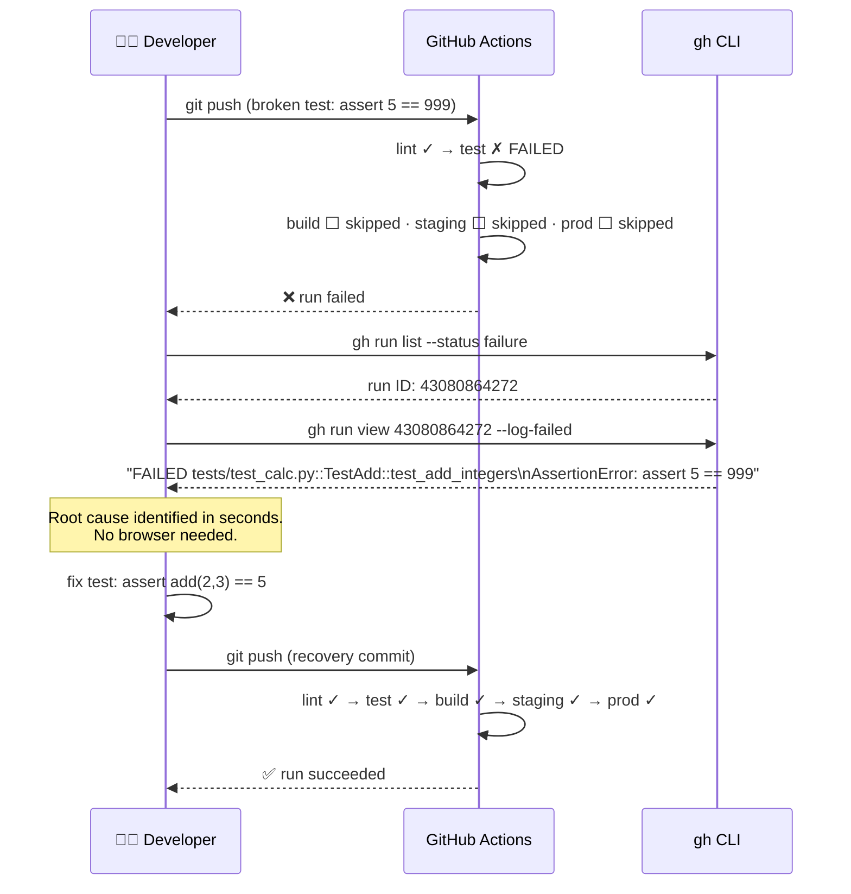

### Common failure signatures

| Symptom in logs | Root cause | Fix |
|---|---|---|
| `This request has been automatically failed because it uses a deprecated version of actions/upload-artifact` | Using `@v3` or earlier — **shut down 2025-01-30** | Change to `@v4` |
| `An artifact with this name already exists` | Uploading twice with the same name in one run (v4 immutability) | Use `name: dist-${{ github.run_id }}` or add `overwrite: true` |
| `Resource not accessible by integration` | Token lacks required scope (e.g. `workflow`, `read:org`) | Re-authenticate with correct scopes |
| `Context access might be invalid: secrets.MY_SECRET` | Secret name typo or secret not created in Settings | Check Settings → Secrets → Actions |
| Deploy jobs shown grey on a PR | Working as intended — `if: github.event_name == 'push'` | No action needed |
| Deploy job runs but health check fails | App is broken at runtime | Fix the code, not the pipeline |
| `Deploy → Production` stuck on "Waiting" | No required reviewer has approved | Click **Review deployments** in the run UI, or `gh run review <id> --approve` |

---

## 7. Run It Yourself

### Prerequisites

- `git` and `gh` CLI installed
- Authenticated: `gh auth login --hostname github.com --scopes "repo,workflow,read:org"`

### Full walkthrough

```bash
# 1. Clone the repo
git clone https://github.com/mariodeleon/cicd-poc.git
cd cicd-poc

# 2. Create a feature branch and make a change
git checkout -b feature/my-change
# edit src/app/calc.py — add a new function, update a docstring, anything
git add .
git commit -m "feat: my change"
git push -u origin feature/my-change

# 3. Open a Pull Request
gh pr create --title "My change" --body "Testing CI pipeline" --base main

# 4. Watch CI run on the PR
gh run list --branch feature/my-change
gh run watch   # live progress in terminal
# Expected: lint ✓  test ✓  build → skipped (PR event)  deploy → skipped

# 5. Merge the PR (triggers full pipeline on main)
gh pr merge --squash --delete-branch

# 6. Watch the full pipeline
gh run list --branch main
gh run watch   # lint ✓ test ✓ build ✓ staging ✓ production → waiting for approval

# 7. Approve production deployment
gh run list --status waiting
gh run review <run-id> --approve

# 8. Confirm production succeeded
gh run view <run-id>
# Check deployment history:
gh api repos/mariodeleon/cicd-poc/deployments --jq '.[0] | {environment, sha, created_at}'

# 9. Download the produced artifact
gh run download <run-id>
ls dist/   # → cicd_poc-0.1.0-py3-none-any.whl

# 10. Trigger the deliberate failure demo
# Edit tests/test_calc.py — change `assert add(2, 3) == 5` to `== 999`
git checkout -b ops/deliberate-failure
git add . && git commit -m "test: deliberate failure for triage demo"
git push -u origin ops/deliberate-failure
gh pr create --title "Deliberate failure" --body "Demo triage" --base main
gh run list --branch ops/deliberate-failure
gh run view <run-id> --log-failed   # see the assertion error
# Fix it, push, watch the recovery
```

---

## Repository Structure

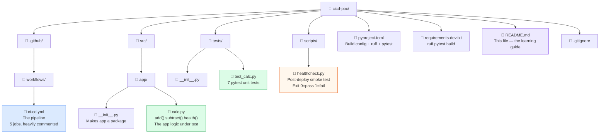

---

## Further Reading

- [GitHub Actions documentation](https://docs.github.com/en/actions)
- [Workflow syntax reference](https://docs.github.com/en/actions/writing-workflows/workflow-syntax-for-github-actions)
- [Using environments for deployment](https://docs.github.com/en/actions/deployment/targeting-different-environments/using-environments-for-deployment)
- [Security hardening (SHA pinning, OIDC)](https://docs.github.com/en/actions/security-for-github-actions/security-guides/security-hardening-for-github-actions)
